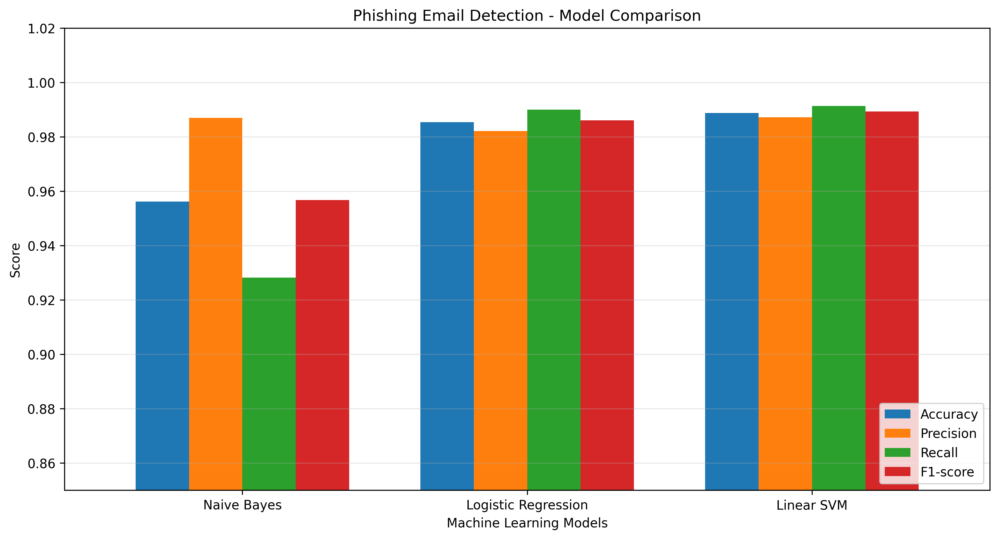
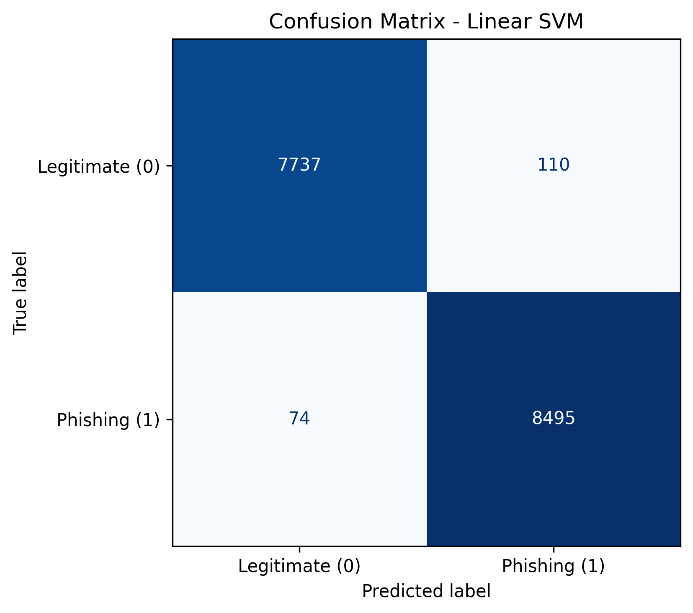
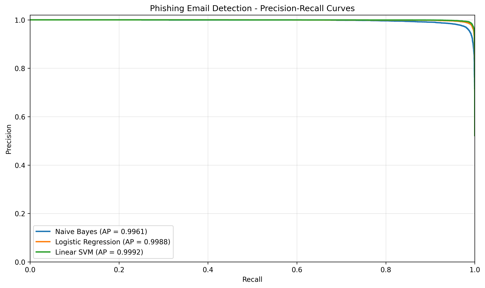
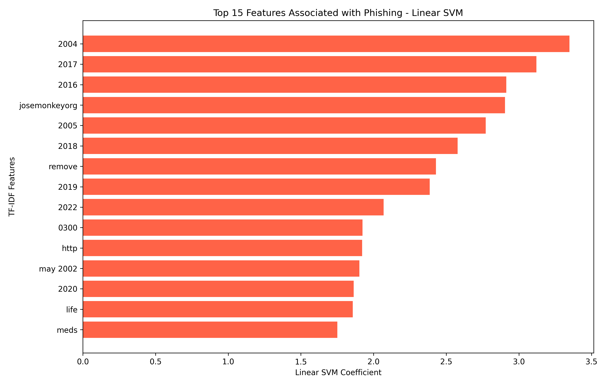

# 🛡️ Phishing Email Detection and Explainable Risk Scoring

## 👥 Team Members

**FPT University – AIC211: AI for Cybersecurity**

1. Lê Trọng Tấn
2. Huỳnh Phúc Khang
3. Trần Quang Trọng
4. Lê Đăng Khoa
5. Trần Thanh Tùng
6. Phan Đặng Gia Khang

---

## 📌 Project Overview

This project develops a machine learning-based system for detecting phishing emails and explaining the factors influencing each prediction.

The system uses Natural Language Processing (NLP), TF-IDF feature extraction, and supervised machine learning algorithms to classify emails as **Legitimate (0)** or **Phishing (1)**.

A Streamlit web application allows users to paste email content, receive a classification result, view a relative phishing risk score, and examine the most influential text features.

## 🎯 Project Objectives

- Detect phishing emails using machine learning.
- Compare multiple classification algorithms.
- Evaluate performance using Accuracy, Precision, Recall, F1-score, and confusion matrices.
- Analyze false positives and false negatives.
- Provide explainable predictions using Linear SVM feature contributions.
- Build an interactive web application for email analysis.

## 🛠️ Technologies Used

| Category | Technologies |
|---|---|
| Programming Language | Python |
| Data Processing | Pandas, NumPy |
| NLP | TF-IDF, Unigrams, Bigrams |
| Machine Learning | Scikit-learn |
| Models | Multinomial Naive Bayes, Logistic Regression, Linear SVM |
| Visualization | Matplotlib |
| Web Application | Streamlit |
| Model Storage | Joblib |
| Development | VS Code, Jupyter Notebook |

## 📊 Dataset

After data cleaning and validation, the dataset contains **82,077 email samples**.

| Category | Samples |
|---|---:|
| Legitimate Emails (0) | 39,233 |
| Phishing Emails (1) | 42,844 |
| Total | 82,077 |

The dataset was divided into training and testing sets using an 80/20 split.

- Training samples: 65,661
- Testing samples: 16,416

The preprocessing pipeline includes text cleaning, duplicate removal, missing-value validation, and TF-IDF feature extraction.

## 🤖 Machine Learning Results

| Model | Accuracy | Precision | Recall | F1-score |
|---|---:|---:|---:|---:|
| Multinomial Naive Bayes | 95.61% | 98.70% | 92.82% | 95.67% |
| Logistic Regression | 98.54% | 98.22% | 99.00% | 98.61% |
| **Linear SVM** | **98.88%** | **98.72%** | **99.14%** | **98.93%** |

**Linear SVM** achieved the highest overall performance and was selected for the web application.

### Model Performance Comparison



### Confusion Matrix – Linear SVM



### Precision–Recall Curves



## 🔍 Explainable AI

The system uses the coefficients of the trained Linear SVM model together with TF-IDF feature values to identify terms contributing to a prediction.

For each analyzed email, the application displays:

- **Phishing Indicators:** Features contributing toward a phishing classification.
- **Legitimate Indicators:** Features contributing toward a legitimate classification.
- **Relative Phishing Risk Score:** A score derived from the model's decision function.

The risk score is a relative model-based indicator, **not a calibrated probability of phishing**.

### Feature Importance Visualization



## 🌐 Streamlit Web Application

The web application provides:

1. Email content input.
2. Phishing or legitimate email classification.
3. Relative phishing risk score.
4. Explainable AI feature contributions.
5. Clear visualization of the analysis result.

## 📁 Project Structure

```text
Phishing-Email-Detection/
│
├── data/
│   └── phishing_email.csv
│
├── models/
│   ├── linear_svm_model.pkl
│   └── tfidf_vectorizer.pkl
│
├── notebooks/
│   └── experiment.ipynb
│
├── result/
│   ├── confusion_matrix_linear_svm.png
│   ├── confusion_matrix_logistic_regression.png
│   ├── confusion_matrix_naive_bayes.png
│   ├── model_comparison.png
│   ├── phishing_feature_importance.png
│   └── precision_recall_curve.png
│
├── app.py
├── README.md
└── requirements.txt
```

## 🚀 Installation and Usage

### Step 1: Install Dependencies

```bash
python -m pip install -r requirements.txt
```

### Step 2: Run the Application

```bash
python -m streamlit run app.py
```

### Step 3: Analyze an Email

Open the local Streamlit URL shown in the terminal, paste an email into the input field, and click **Analyze Email**.

## ⚠️ Limitations

- Predictions depend on the quality and representativeness of the training dataset.
- New phishing techniques may reduce model performance.
- False positives and false negatives remain possible.
- Feature contributions explain the model's decision, not necessarily the actual intent of the email sender.
- The relative risk score should not be interpreted as a calibrated probability.

## 📚 Conclusion

This project demonstrates an end-to-end AI pipeline for phishing email detection, including data preprocessing, feature extraction, model training, evaluation, explainability, and deployment.

Among the evaluated algorithms, Linear SVM achieved the best performance, with **98.88% accuracy** and **98.93% F1-score** on the test set.

The Streamlit application provides an accessible demonstration of machine learning and explainable AI for cybersecurity education.

---

**FPT University | AIC211 – AI for Cybersecurity**

*This project is intended for educational and research purposes.*